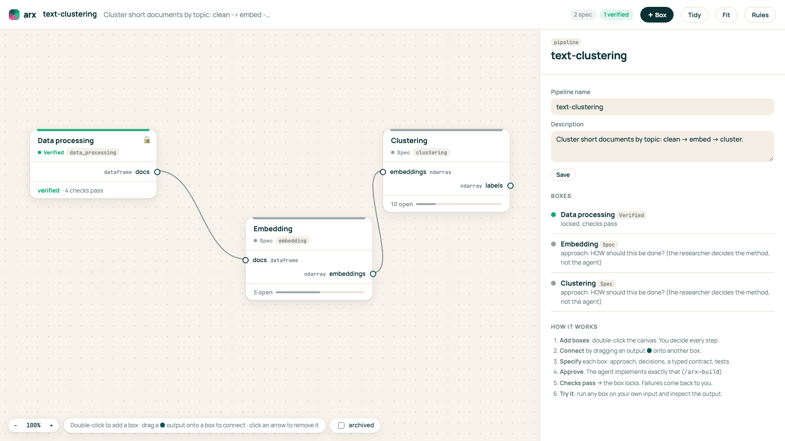
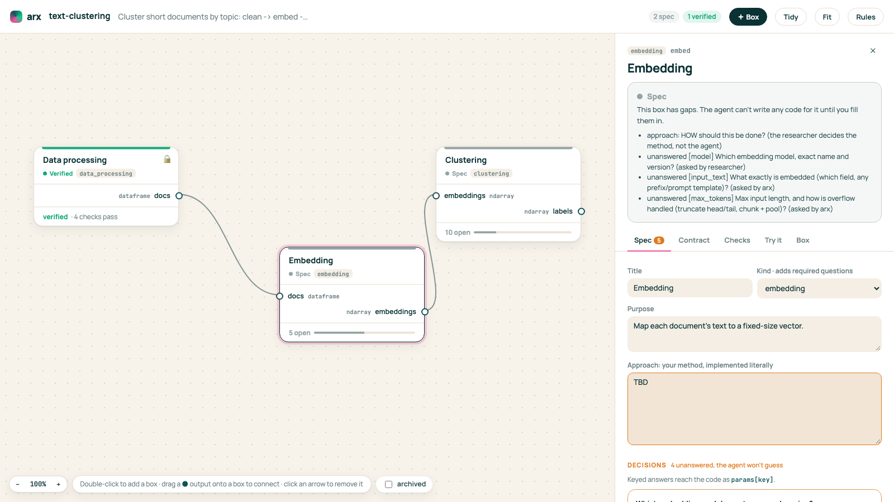
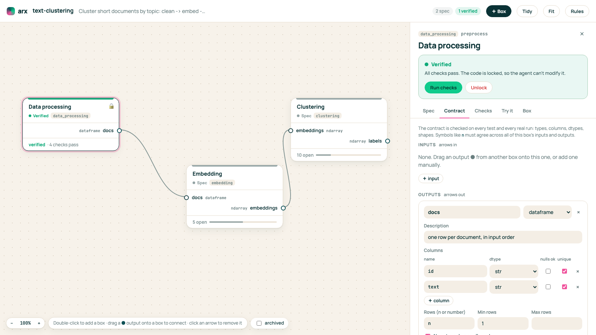

# agentic-research (`arx`)

A tool that keeps research code written by an agent from drifting away from what the researcher intended.

**The researcher designs the pipeline. The agent writes only the code, and only within your spec.**
Each stage (box) has a spec in `pipeline.yaml`:

- the **approach**: how the stage must be done
- the **decisions** you have to make for this kind of stage
- the **constraints** the code must respect
- the **checks** that define "correct"

**You drive, the agent implements.** You lay out every box yourself on a flow canvas. The agent never
proposes stages, methods or parameters. It only asks neutral questions about what you left unspecified,
and when a box keeps failing it stops and reports back to you.

A gate enforces the spec in Claude Code using hooks, and in Codex using `AGENTS.md` plus a git pre-commit check:

```
 draft ──(you fill in every box)──▶ ready ──(you approve)──▶ approved ──(agent implements,
   ▲                                                                     `arx verify` passes)──▶ verified 🔒
   └── agent hits something unspecified: it must STOP, `arx ask`, and ask you
```

- **No guessing.** If a stage's approach, outputs, constraints, tests or required questions are missing,
  the agent can't write that stage's code. The denial message tells it to stop and ask you.
- **You fill in the blanks.** Each `kind` comes with questions that have to be answered.
  - `embedding` asks for the model, the exact input text, truncation and normalization.
  - `clustering` asks for the algorithm, distance metric, how k is chosen, any reduction step, noise handling, seed and evaluation metric.

  Answers reach the code as `params[key]`, so the agent can't hardcode its own choices.
- **The agent can say what's unclear but can't decide it.** `/arx-review` has the agent look for gaps
  and weak checks in the spec. It records them with `arx ask`, offering options, then asks you. Only
  you can approve.
- **Verified means locked.** When a stage's tests and invariants pass, its files are hashed and locked.
  The agent can't edit them, and edits that slip through show up as `TAMPERED`. Changing an
  upstream stage marks downstream stages `STALE`.
- **Failures come back to you as boxes.** After `max_attempts` failed verifies (3 by default), a box
  moves to **Needs you** and the agent is locked out. You choose what happens next:
  - revise the box
  - **insert a box before** it, which rewires its inputs through the new box
  - **try an alternative**, a sibling box with the same contract and checks but your new method. Use
    "Use this instead" to rewire downstream boxes to it and archive the original.
  - give the agent more attempts
- **No boilerplate.** `arx scaffold` generates each stage module from the spec. `arx verify` runs the
  tests, contract checks and invariants on real data, `arx run` executes the pipeline with caching, and
  `arx ui` gives you the boxes and arrows.



## Quick start

```bash
pip install -e .                    # once, in the env you'll run Claude Code from

cd examples/text-clustering && arx ui     # try the example
# or start your own:
mkdir ~/my-research && cd ~/my-research && arx ui   # offers to start an empty flow here
```

`arx` on its own prints what's blocked and what's next. `arx init <dir> --example` creates a copy of the
example (data included) anywhere you like.

Then, in Claude Code inside that project:

- `/arx-review`: the agent critiques the spec and asks you about every gap
- `/arx-build`: the agent implements the next approved stage until `arx verify` passes, then stops

Codex reads the same protocol from `AGENTS.md`.

A complete example lives in [examples/text-clustering](examples/text-clustering):
`preprocess` is fully specified, while `embed` and `cluster` still have gaps for you to fill in.

## A stage spec

```yaml
- id: embed
  kind: embedding                 # adds required questions: model, input_text, max_tokens, normalize
  purpose: Map each cleaned text to a fixed-size vector.
  approach: Use sentence-transformers all-MiniLM-L6-v2, batch 64, L2-normalize.
  inputs:  [{name: texts, from: preprocess.texts, type: "list[str]"}]   # the arrow
  outputs: [{name: embeddings, type: ndarray, description: "(n, 384) float32"}]
  decisions:
    - {key: model, question: Which model?, answer: all-MiniLM-L6-v2}
  constraints: [row order matches input texts]
  tests:        # hand-made cases: input -> expected
    - {name: one row per text, input: {texts: [a, b]}, expect: "out['embeddings'].shape[0] == 2"}
  invariants:   # must hold on the REAL upstream data
    - {name: finite, expr: "bool(np.isfinite(out['embeddings']).all())"}
```

A stage module is `def run(inputs, params, ctx=None) -> dict`. Plots written to `ctx.artifact_dir`
show up in the UI next to the check results.

## Commands

| command | who | |
|---|---|---|
| `arx status` · `arx next` · `arx check [stage]` | anyone | what's blocked and why |
| `arx ask <stage> "q" --key k` | agent | raise a neutral question (blocks the stage; `--option` only if Rules allow) |
| `arx answer <stage> <key> "value"` | agent/you | record an answer (agent answers are flagged for your review) |
| `arx approve` · `arx unlock` · `arx retry <stage>` | **you only** | needs an interactive terminal, or use the UI |
| `arx scaffold <stage>` | agent | generate the module from the approved spec |
| `arx verify <stage>` | anyone | tests + contract + invariants; locks on pass |
| `arx run [stage] [--unverified]` | anyone | run on real data, summarize outputs |
| `arx ui` | you | the flow editor at http://127.0.0.1:8765 |

### The flow editor
- **Boxes and arrows:**
  - Double-click the canvas (or click **＋ Box**) to add a box.
  - Drag a box by its header to move it.
  - Drag an output dot ● onto another box to connect them. The input inherits that output's contract.
  - Click an arrow to remove it.
  - Scroll to pan, and pinch or ⌘-scroll to zoom. **Tidy** arranges the boxes left to right.
- **Inspector:** clicking a box opens it on the right. At the top is its status, with the actions that
  fit: Approve, Run checks, Unlock, Retry. Below that are five tabs:
  - **Spec**: approach, decisions and constraints.
  - **Contract**: typed inputs and outputs. For example, a dataframe declares its columns, dtypes, and
    whether each column allows nulls or must be unique. An array declares its dtype and shape. A list
    declares its item type and length.
  - **Checks**: test cases, invariants, the last run's results, and a preview of the real-data output.
  - **Try it**: run the box on your own JSON input or on the real upstream data, see the output as
    tables and stats, and save what you tried as a test case.
  - **Box**: insert a box before it, add a box after it, try an alternative approach, archive or delete it.
| Spec: your method and decisions | Contract: typed, enforced inputs and outputs |
|---|---|
|  |  |

- **Rules:** set the attempt limit, the minimum number of checks per box, strict contracts, and whether
  the agent may suggest answers.

### Contracts
Every port has a type and a schema. arx checks them on every test and every real run, before
any of your own checks run:

```yaml
outputs:
  - name: docs
    type: dataframe
    schema:
      rows: n                     # symbol: must agree with other ports of this box
      exact_columns: true
      columns:
        - {name: id,   dtype: str, nullable: false, unique: true}
        - {name: text, dtype: str, nullable: false}
  - name: embeddings
    type: ndarray
    schema: {dtype: float32, shape: [n, "*"], finite: true}
```

With strict contracts on (the default), a box can't be approved until each output is fully pinned down:
- a dataframe declares its columns
- an array declares its dtype and shape
- a list declares its item type

In test cases and in Try it, inputs written as JSON are converted to the declared type. A list of
row objects becomes a DataFrame, and nested lists become an array.

## How it's enforced, and its limits

| layer | Claude Code | Codex |
|---|---|---|
| Context: protocol + live status injected every turn | ✅ SessionStart / UserPromptSubmit hooks | `AGENTS.md` |
| Blocks edits to the spec, `.arx/`, and unapproved or locked stage files | ✅ PreToolUse hook | ❌ (instructions only) |
| Blocks `arx approve/unlock` and shell writes to protected files | ✅ PreToolUse hook (pattern match) | ❌ |
| Approve/unlock need a real TTY | ✅ | ✅ |
| Tamper detection via file hashes (`arx check --ci`, pre-commit) | ✅ | ✅ |

If `arx` isn't installed in the environment Claude Code runs in, the hooks refuse every edit and shell
command rather than letting them through unchecked.

The hooks keep a cooperative agent from drifting. They are not a sandbox: a determined process
could still write files in ways the shell patterns don't catch. Hash-based tamper detection is the
backstop. Saving from the UI rewrites `pipeline.yaml` and drops YAML comments.
